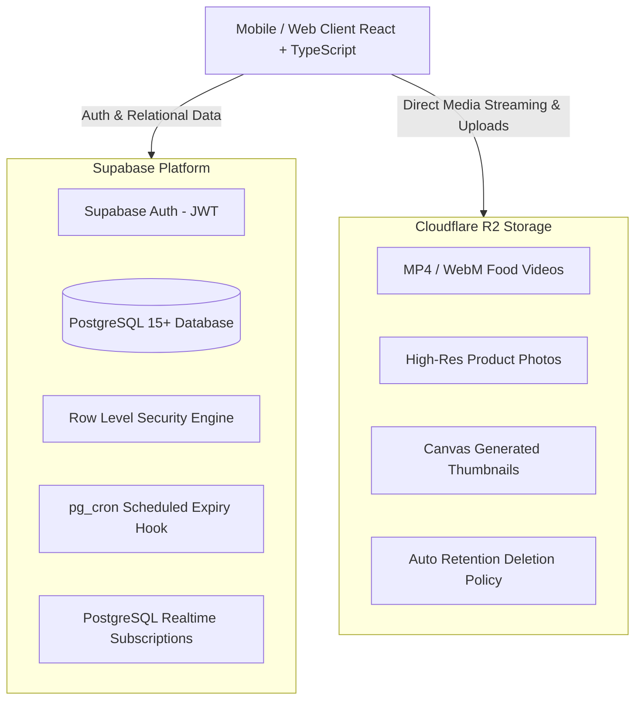

# CraveDrop Technical Architecture

CraveDrop is a mobile-first social food discovery and direct-ordering platform. Normal users discover fresh, limited-time food specials ("Food Drops") through short-form video and high-resolution photo feeds, while restaurants act as content creators and vendors.

---

## 1. High-Level System Architecture

---

## 2. Core Architectural Principles

### 2.1 Separation of Media and Transactional Data
- **No binary data in PostgreSQL**: All video clips, high-resolution food photos, and thumbnails are stored exclusively in **Cloudflare R2 Object Storage** (S3-compatible API).
- **Metadata in PostgreSQL**: The database stores only media URLs, MIME types, file sizes, durations, and critical `expires_at` timestamps.
- **CDN Distribution**: Media is delivered over Cloudflare's global edge network for sub-second video buffer times on mobile networks.

### 2.2 Server-Side Expiry Enforcement (Zero Trust Client Clock)
- Frontend countdown badges (`Ends in 08m`, `Ends in 42m`, `Available today`) provide immediate visual feedback.
- **Authoritative Validation**: The backend strictly validates:
  $$\text{current\_server\_time} \ge \text{expires\_at}$$
  If a post has expired, direct checkout is rejected, regardless of frontend state or local device clock manipulation.
- When expired, metadata is preserved for restaurant sales analytics, but the drop ceases to be orderable or recommended in discovery feeds.

### 2.3 Single-Restaurant Cart Flow
- To eliminate split checkout friction and delivery scheduling conflicts in Version 1, each cart holds items from **one restaurant at a time**.
- If a customer adds an item from Kitchen B while their bag contains items from Kitchen A, the UI presents an explicit confirmation modal before clearing and switching kitchens.

### 2.4 Server-Side Price Verification
- Clients transmit only `productId` and `quantity`.
- Unit prices, discounts, and delivery fees are re-calculated directly against the authoritative database record at checkout time, preventing client-side price tampering.

---

## 3. User Roles & Access Control

| Role | Capabilities | Protected Routes |
|---|---|---|
| **Customer** | Browse feeds, like, comment, share, save, follow kitchens, place COD orders, track live status, submit reviews. | Profile, Bag, Checkout, Order Tracking |
| **Restaurant Partner** | Publish food drops with 1h/3h/6h/12h/24h/custom expiry, upload videos/images, accept/reject orders, advance kitchen status, view revenue/conversion analytics. | Partner Dashboard, Menu Manager, Orders Console, Kitchen Analytics |
| **Admin** | Approve/reject restaurant partners, moderate reported content, take down violating posts/comments, review platform GMV metrics. | Admin Dashboard, Moderation Queue, Partner Approvals, Metrics |

---

## 4. Internationalization (i18n)

- Integrated translation provider supporting **English** and **Urdu (اردو)**.
- Dynamic bidirectional layout: Urdu automatically triggers `dir="rtl"` and loads Noto Nastaliq Urdu typography.
- Centralized translation dictionary located in `src/i18n/`.
