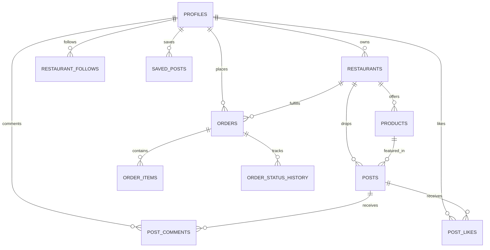

# CraveDrop Database Schema & RLS Security

The CraveDrop database is designed for PostgreSQL 15+ running on Supabase with Row Level Security (RLS) enabled across every table.

---

## 1. Schema Tables Overview



### Table Definitions

| Table | Description | Primary Key | Foreign Keys |
|---|---|---|---|
| `profiles` | User accounts (Customer, Restaurant, Admin) | `id (UUID)` | References `auth.users(id)` |
| `restaurants` | Kitchen vendor profiles, ratings, locations, delivery fees | `id (UUID)` | `owner_id -> profiles(id)` |
| `categories` | Global food categories (Burgers, Pizza, Desi, Japanese, Cafe, etc.) | `id (UUID)` | - |
| `products` | Restaurant menu items, unit prices, discounts, prep times | `id (UUID)` | `restaurant_id -> restaurants(id)` |
| `posts` | Limited-time food video/image drops with `expires_at` | `id (UUID)` | `restaurant_id`, `product_id` |
| `post_likes` | Many-to-many unique like records | `(post_id, user_id)` | `post_id`, `user_id` |
| `post_comments` | User comments with moderation flags | `id (UUID)` | `post_id`, `user_id` |
| `restaurant_follows` | Many-to-many restaurant follower graph | `(restaurant_id, user_id)` | `restaurant_id`, `user_id` |
| `saved_posts` | User bookmarked drops | `(user_id, post_id)` | `user_id`, `post_id` |
| `orders` | Direct food orders (Cash on Delivery) | `id (UUID)` | `customer_id`, `restaurant_id`, `associated_post_id` |
| `order_items` | Individual line items per order | `id (UUID)` | `order_id`, `product_id` |
| `order_status_history`| Audit timeline of status transitions | `id (UUID)` | `order_id` |
| `notifications` | In-app user notifications (orders, drops, follows) | `id (UUID)` | `user_id` |
| `reports` | Moderation reporting queue for abusive content | `id (UUID)` | `reporter_id` |

---

## 2. High-Performance Indexes

The following composite and b-tree indexes ensure fast feed queries and quick order status lookups:

```sql
CREATE INDEX idx_posts_expires_at ON public.posts (expires_at);
CREATE INDEX idx_posts_created_at ON public.posts (created_at DESC);
CREATE INDEX idx_posts_restaurant_id ON public.posts (restaurant_id);
CREATE INDEX idx_products_restaurant ON public.products (restaurant_id);
CREATE INDEX idx_orders_customer ON public.orders (customer_id);
CREATE INDEX idx_orders_restaurant ON public.orders (restaurant_id);
CREATE INDEX idx_orders_status ON public.orders (status);
```

---

## 3. Automatic Expiry Cron Function

In production PostgreSQL, a scheduled worker runs every minute using `pg_cron` or Supabase Edge Functions:

```sql
CREATE OR REPLACE FUNCTION public.check_expired_food_posts()
RETURNS void AS $$
BEGIN
  UPDATE public.posts
  SET is_expired = true
  WHERE expires_at <= timezone('utc'::text, now()) AND is_expired = false;
END;
$$ LANGUAGE plpgsql SECURITY DEFINER;
```

---

## 4. Row Level Security (RLS) Policy Specifications

### Customers
- Can read public profiles and update only their own profile: `auth.uid() = id`.
- Can view their own orders: `auth.uid() = customer_id`.
- Cannot view or tamper with other customers' orders or addresses.
- Can create and delete their own comments.

### Restaurant Partners
- Can view and manage only products and posts owned by their restaurant:
  `EXISTS (SELECT 1 FROM public.restaurants WHERE id = products.restaurant_id AND owner_id = auth.uid())`
- Can view incoming orders placed to their restaurant and update status:
  `EXISTS (SELECT 1 FROM public.restaurants WHERE id = orders.restaurant_id AND owner_id = auth.uid())`
- Cannot modify menu items or view orders belonging to other kitchens.

### Admins
- Server-side verified role (`role = 'admin'`) permits reviewing reports, approving kitchens, and removing reported posts.
